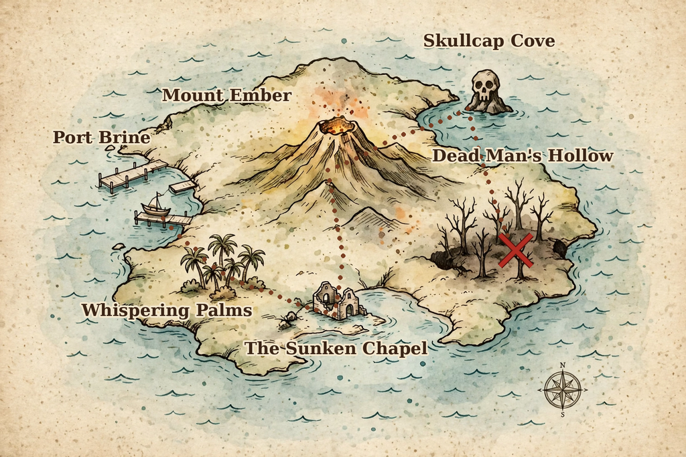

# Charm the Cartographers — a treasure map



A hand-inked island chart in sepia and faded teal, drawn for the
Cartographers. Six landmarks carry the story, and a dotted route walks
them in order:

1. **Port Brine** — the little harbour on the west coast where every
   voyage starts, docks and one patient boat included.
2. **Whispering Palms** — the grove in the south-west that leans away
   from the wind and toward the rumour.
3. **The Sunken Chapel** — a ruined chapel standing in the lagoon
   shallows on the south shore, bells long gone, stones still praying.
4. **Mount Ember** — the volcano at the island's heart, glowing just
   enough to warn you it is awake.
5. **Skullcap Cove** — the north-east bay watched over by a skull of
   stone that has seen every landing and judged them all.
6. **Dead Man's Hollow** — the dead-tree hollow in the east, where the
   dotted line ends the way it should: with a red X.

## Run it

```sh
python3 main.py
```

Writes the finished map (1024x683 PNG) to `/output/entry.png`,
byte-for-byte identical to `map.png` in this repository. No inputs,
no network, no dependencies beyond the Python standard library.

## Built for make.fun

Entered in *Charm the Cartographers* on make.fun.
Referral code: zacyhh0y
